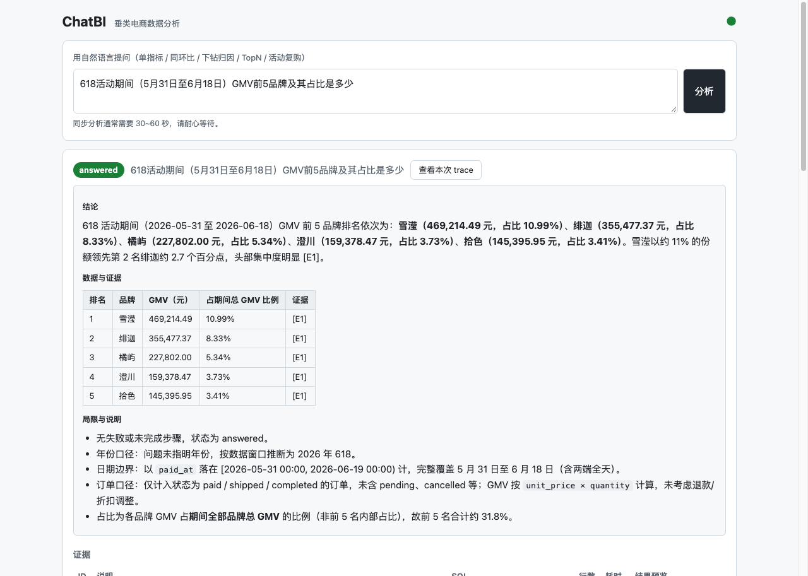

# chatbi-agent

[](https://github.com/Thekshy/chatbi-agent/actions/workflows/ci.yml)

垂类电商（美妆 / 服饰）ChatBI 智能体：自然语言提问 → LangGraph Plan-Execute 编排 →
schema 检索 → text2sql → 只读查询 → 下钻 / 指标计算，输出带数据证据的结构化分析结论。

规格见 [SPEC.md](SPEC.md)，任务拆解见 [TICKETS.md](TICKETS.md)。当前进度：**v1 完成（T1–T11 全部收口）**。
离线评测 50 题 × 3 采样实测：结论正确率 70%、一致性 92% 达标；执行正确率 76%、纠错成功率 0% 未达标，
明细与原因见下文[评测](#评测)与[未达标项与已知问题](#未达标项与已知问题)。

深入文档（docs/）：
[架构与数据流](docs/架构与数据流.md) ·
[评测方法与指标定义](docs/评测方法与指标定义.md) ·
[安全边界设计](docs/安全边界设计.md) ·
[深挖讲解地图（函数级）](docs/深挖讲解地图.md)

运行实拍（真实 LLM + 真实 mock 库，2026-10-04）：Web 结论区（TopN 问法，含局限与说明）
；
CLI 终端渲染（单指标问法，结论/证据/步骤时间线）见
[docs/assets/cli-分析输出.svg](docs/assets/cli-分析输出.svg)。

## 技术栈

Python 3.12 + uv · PostgreSQL 17（本机 Homebrew）· LangGraph（StateGraph + SqliteSaver）·
智谱 GLM（`glm-5.3`，OpenAI 兼容）· sqlglot（AST 校验）· FastAPI + 原生 JS 单页（v1 Web 壳）

## 架构简图

```
question ──► planner ──► executor ──► reporter ──► {answered | partial | failed} + 证据
                │           │  ▲                        ▲
                │           │  └── reflect（≤2 次/条 SQL：报错回灌 error+schema，
                │           │       空集/口径不符回灌 get_data_profile 分布提示）
                │           ▼
                │      工具层（只读边界四件套）
                │      get_schema / get_data_profile / validate_sql / run_query
                │           │  validate_sql：sqlglot AST——单条 SELECT、表白名单、
                │           │               拒 DDL/DML、canonical 指纹去重、自动 LIMIT(1000)
                │           │  run_query：chatbi_ro 只读连接、statement_timeout=5s
                │           ▼
                └────── replan（≤1 次，换路径后仍失败 → failed 结构化报告）

预算守卫：maxSteps=6 · LLM 调用 ≤8 · run_query ≤5，超限走 reporter 输出 partial
trace：每次分析全量落盘 runs/<run_id>/trace.jsonl；SqliteSaver checkpoint 独立 thread_id
```

分层：`src/chatbi/`（state / graph / llm / metrics / prompts / tools / tracing / api / web），
`eval/`（dataset + runner + report），`data/`（mock 生成器）。

## 目录结构

```
├── SPEC.md / TICKETS.md     # 规格与任务（唯一对齐依据）
├── docs/                    # 架构 / 评测方法 / 安全边界 / 深挖讲解地图（含运行截图）
├── .github/workflows/ci.yml # CI：ruff + 150 条单测（不依赖真实 LLM key / PG）
├── Dockerfile               # Web 壳容器（本地可跑；PG 留在宿主机）
├── pyproject.toml           # uv 管理，运行 + 开发依赖
├── .env.example             # 环境变量模板（复制为 .env）
├── src/chatbi/              # 核心库（api.analyze() 为评测与 Web 共用唯一入口）
├── data/                    # mock 生成器（种子 20260915，一键重建 5 表 + 植入故事）
├── eval/                    # 50 题标注集 + 评测 harness + reports/（评测产物入库）
├── runs/                    # trace 落盘（gitignore；评测 trace 在 runs/eval/）
└── tests/                   # pytest（163 条；13 条 integration 需本机环境，CI 排除）
```

## 环境准备（一次性）

```bash
# 1. 依赖
uv sync

# 2. PostgreSQL（Homebrew，已装 17.11 的前提下）
brew services start postgresql@17

# 3. 建库与双账号（超级用户执行；密码自行生成替换）
psql -h 127.0.0.1 -d postgres \
  -c "CREATE ROLE chatbi_app LOGIN PASSWORD '<app_password>';" \
  -c "CREATE ROLE chatbi_ro LOGIN PASSWORD '<ro_password>';" \
  -c "CREATE DATABASE chatbi OWNER chatbi_app;" \
  -c "REVOKE ALL ON DATABASE chatbi FROM PUBLIC;" \
  -c "GRANT CONNECT ON DATABASE chatbi TO chatbi_app, chatbi_ro;" \
  -c "REVOKE CREATE ON SCHEMA public FROM PUBLIC;" \
  -c "GRANT USAGE, CREATE ON SCHEMA public TO chatbi_app;" \
  -c "GRANT USAGE ON SCHEMA public TO chatbi_ro;" \
  -c "ALTER DEFAULT PRIVILEGES FOR ROLE chatbi_app IN SCHEMA public GRANT SELECT ON TABLES TO chatbi_ro;"

# 4. 配置 .env（ZHIPU_API_KEY 来自智谱开放平台）
cp .env.example .env && $EDITOR .env

# 5. 生成 mock 库（drop + recreate 全量重建，SPEC §5.3 故事数值随种子复现）
uv run python -m data.mock_gen
```

账号约定（SPEC §6.3 / §7）：`chatbi_app` 读写、仅 mock 生成器持有；`chatbi_ro` 只读、
运行时（工具层 run_query）唯一连接方式，public schema 无 CREATE 权限。

## 使用说明

```bash
# 1. 起 Web 服务（绑定 127.0.0.1:8000，单用户无鉴权）
uv run python -m chatbi.web
#    浏览器打开 http://127.0.0.1:8000 —— 提问框、loading、结论区、证据表格
#    （SQL + 结果预览）、步骤时间线、token 用量、历史 trace 查看

# 2. 或者命令行调试（rich 呈现结论 + 证据 + 步骤）
uv run python -m chatbi.ask "上个月护肤品类的 GMV 是多少"

# 3. 看某次分析的完整 trace
#    每次分析落盘 runs/<run_id>/trace.jsonl（message / tool_call / sql_result /
#    step / conclusion 事件，含耗时、行数、token）；评测的 trace 在 runs/eval/ 下。
#    也可以在 Web「历史」页或 GET /api/traces 浏览。

# 4. 复跑评测 / 校验标注集
uv run python -m eval.runner --samples 3          # 全量 50 题 × 3 采样（约 2 小时）
uv run python -m eval.runner --type topn --samples 1   # 子集：按题型 / --id / --limit
uv run python -m eval.validate_dataset --check    # 标注集标准 SQL 连库核对（50/50）
```

单次分析同步等待约 30–60s（实测平均 53s/次）。问题范围见 SPEC §3（单指标 / 同环比 /
下钻归因 / TopN / 活动复购增量，4+1 类问法）。

## 测试与 CI

```bash
uv run pytest                        # 全量 163 条（含 integration：本机 PG + key，缺失自动 skip）
uv run pytest -m "not integration"   # 150 条纯单测（FakeLLM / 工具替身 / ASGI mock），CI 同口径
uv run ruff check .                  # lint
```

GitHub Actions（`.github/workflows/ci.yml`）：push / PR 触发 ruff + 150 条单测，
不依赖真实 LLM key 与本机 PG。Docker 本地跑 Web 壳：`docker build -t chatbi-agent .`
后 `docker run --rm -p 8000:8000 --env-file .env -e PG_DSN_RO=... chatbi-agent`
（容器内连宿主机 PG 把 127.0.0.1 换 host.docker.internal，详见 Dockerfile 头注）。

## 评测

离线评测（SPEC §8.2）：50 题标注集 × 每题 3 次独立采样，题级严格多数聚合。
完整报告（失败题明细、逐 run 证据与 trace 路径）见
[eval/reports/eval_50x3.md](eval/reports/eval_50x3.md)（同名 `.json` 附完整结构）。

- 运行：2026-09-16 · 模型 `glm-5.3` · 耗时 7990s（150 次分析，平均 53.3s/次）
- 数据集：50/50 标准 SQL 连库校验通过（orders=104,209，静态 mock 库）
- 结果状态分布：answered 146 / partial 3 / failed 1（150 次）

### 总体（实测 vs 目标）

| 指标 | 实测 | 目标 | 达标 |
|---|---|---|---|
| 执行正确率 | 38/50（76.0%） | ≥80% | ❌ |
| 结论正确率 | 35/50（70.0%） | ≥70% | ✅ |
| 纠错成功率（脏题） | 0/5（0.0%） | ≥50% | ❌ |
| 采样一致性 | 46/50（92.0%） | ≥80% | ✅ |

### 分层明细

| 类型 | 题数 | 执行 | 结论 | 一致 |
|---|---|---|---|---|
| 单指标 | 15 | 14/15（93.3%） | 14/15（93.3%） | 15/15（100.0%） |
| 同环比 | 10 | 10/10（100.0%） | 10/10（100.0%） | 10/10（100.0%） |
| 下钻归因 | 12 | 3/12（25.0%） | 0/12（0.0%） | 8/12（66.7%） |
| TopN | 8 | 7/8（87.5%） | 7/8（87.5%） | 8/8（100.0%） |
| 纠错脏题 | 5 | 4/5（80.0%） | 4/5（80.0%） | 5/5（100.0%） |
| **合计** | **50** | **38/50（76.0%）** | **35/50（70.0%）** | **46/50（92.0%）** |

（纠错成功率分层即上表脏题行的 0/5，题级多数决口径见报告。）

### Token 与调用消耗

| 项 | 合计 | 每题平均 |
|---|---|---|
| LLM 调用 | 541 | 10.8 |
| run_query | 211 | 4.2 |
| tokens_in | 506,651 | 10,133 |
| tokens_out | 469,458 | 9,389 |

订阅制模型无按 token 单价，费用以 token 用量计（SPEC §7）。下钻归因层消耗最高
（36 次采样、159 次 LLM 调用、tokens_in 16.7 万 / tokens_out 22.5 万），其余四层
114 次采样合计 tokens_in 34.0 万 / tokens_out 24.4 万。

## 未达标项与已知问题

以下为 2026-09-16 全量评测实测结论，按纪律**不做针对性 hack**，原样呈现留 v2 决策。

1. **执行正确率 76% < 80%（差 4 题），主因下钻归因层 3/12**。非下钻层合计 35/38（92%）。
   下钻层失败拆解（题级，12 题中）：
   - *基线期选择歧义*（dr004 / dr007 / dr009 / dr010 / dr011，5 题）：「相比常规期 /
     上周同期 / 前一周」的基线窗口没有唯一解，Agent 选择的基线（如双 11 取 10-21~10-31
     同长度 11 天）与标注（10-01~10-11）不同，渠道 / 品类增量的 delta 与 share 随之大幅偏离。
   - *分解口径差异*（dr001，1 题）：SPEC §5.3 的规范分解是
     (1+UV 环比)×(1+单位 UV 产出环比)−1，Agent 用了绝对增量贡献分解，结论缺
     uv_change / yield_change 因子数值（偏差 3.4% / 32.3%）。
   - *维度覆盖不全*（dr002 / dr005 / dr008，3 题）：执行正确（维度分解 SQL 全部命中），
     但标注口径要求全部维度按序出现在结论文本中，Agent 只呈现主要贡献维度
     （如护肤 6 月下滑题漏了正贡献的「防晒」）。
   - *时间粒度格式与边界*（dr003，1 题）：日粒度下钻的日期 dim 格式与首日边界和标注
     不一致（偏差 11.5%）。
   - *预算耗尽*（dr006，3 次采样全部 partial）：流量 vs 转化分解需要多步查询，
     Q5 预算（LLM ≤8 / query ≤5）对这类两步分解题偏紧，3 次均以规则模板收尾。
   - *复购基线窗口*（dr012，1 题）：基线期新客窗口取整月 vs 标注取活动前 30 天，
     基线复购率差 2.9%（11.30% vs 10.98%），超 ±2% 容差。
2. **「618 大促期间」窗口歧义（sm005 / tn001 两题，非下钻层仅有的执行失败）**：
   Agent 先检索到活动日历（2026-05-31 起）并在结论文本中引用，但统计窗口用了
   06-01~06-19，与标注口径 [05-31, 06-19) 相差约 5.8%~6.1%，三次采样稳定复现。
3. **纠错成功率 0/5 < 50%，属结构性零分而非 Reflexion 失效**：该指标只统计 5 道脏题中
   「首轮 SQL 失败但最终 answered 且正确」的题。实测 4/5 脏题首轮 SQL 直接正确
   （dt001 退款口径 / dt002 客单价分母 / dt004 时间边界均一次答对），没有失败可纠；
   dt003（超范围品类）3 次采样中 1 次发生首轮失败并成功恢复，题级多数决（1/3）判否；
   dt005 为无解题，按口径不进分子。Reflexion 机制本身有效：全量 150 次分析中 42 次
   首轮 SQL 失败、13 次自修正后 answered 且执行正确（如 dr009 第 3 次采样全程恢复）。
4. **环境抖动**：dt005 第 3 次采样遇 LLM 端点 `APITimeoutError`（replan 阶段重试后仍
   失败），转 failed 结构化报告；150 次中仅此 1 次由环境异常收尾。
5. **结论正确率 70% 恰好压线**：非下钻层 35/38（92%），下钻层 0/12 全军覆没（原因见 1）。
6. **采样一致性 92% 达标**：4 题不稳定均在下钻层（dr004 / dr006 / dr008 / dr009），
   与基线期歧义、预算耗尽同源。

## v1 边界

单轮问句、同步响应（无流式）、静态 mock 库、无澄清反问、无图表生成、无多用户/鉴权——
完整非目标清单见 SPEC §4。
